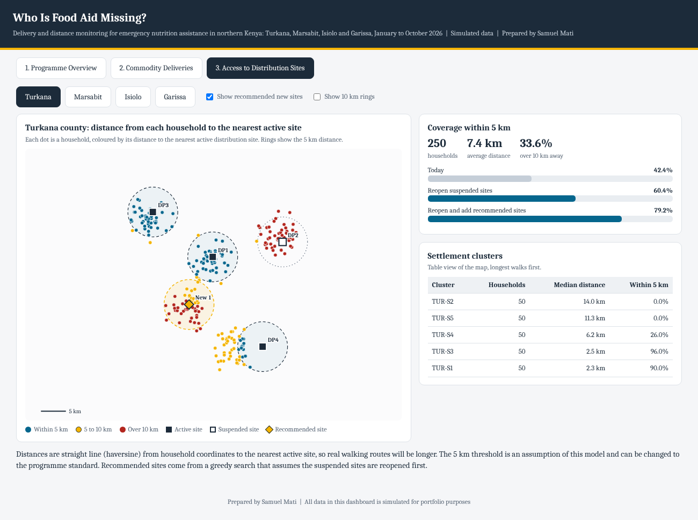

# Who Is Food Aid Missing?

**Delivery and distance monitoring for emergency nutrition assistance in northern Kenya.**

A monitoring, evaluation, accountability and learning (MEAL) analytics project for humanitarian food and nutrition assistance. It tracks whether emergency nutrition commodities reach registered vulnerable households on schedule, and how far households live from the nearest distribution site. Messy registration and distribution data goes through SQL modelling, Python data quality checks and a distance analysis, and ends in an interactive dashboard and a briefing memo for programme leadership.

The approach suits food assistance and nutrition programmes run by organisations such as WFP, Catholic Relief Services and similar agencies, and can be repointed at real programme data.

By Samuel Mati.


## Important note on the data

All data in this repository is **simulated**. It covers 1,000 households, 16 distribution sites, four ASAL counties (Turkana, Marsabit, Isiolo, Garissa) and ten months (January to October 2026). It was built to demonstrate the method and does not describe any real programme or organisation. Coordinates are approximate and for illustration only.

The raw files contain deliberate errors (duplicates, missing values, swapped quantities, bad coordinates) so the cleaning step has real work to do. The generator is seeded, so every run produces identical data.

## Business question

Are emergency nutrition commodities reaching targeted vulnerable households across high risk ASAL counties on schedule, and where do households live too far from a distribution site (over 5 km)?

## Headline results

| Measure | Result |
|---|---|
| Rations delivered against target | 7,941 of 10,000 (79.4%) |
| Commodity received against plan | 621.4 of 710.0 MT (87.5%) |
| Households within 5 km of an active site | 54.2% |
| Households over 10 km from an active site | 22.8% |
| Reach rate within 5 km, 5 to 10 km, over 10 km | 92.4%, 75.8%, 52.1% |
| Households within 5 km after reopening 2 suspended sites | 63.5% |
| Households within 5 km after reopening and adding 5 new sites | 87.1% |

Other findings: Marsabit and Turkana have the weakest access (38.8% and 42.4% within 5 km), four county level supply breaks stand out (Marsabit in March and April, Turkana in June, Garissa in August), and Super Cereal fell to about 60% of plan in September and October across all counties.

## What this project demonstrates

| Skill | Where to look |
|---|---|
| Relational modelling with keys and checks | `sql/01_schema.sql`, `docs/erd.png` |
| SQL window functions (LAG, SUM OVER, RANK) | `sql/02_analysis_queries.sql` |
| Python ETL and data validation | `python/clean_meal_data.py`, `data/clean/data_quality_log.csv` |
| Spatial analysis without a GIS licence | `python/walk_less_analysis.py` |
| Dashboard design and interaction | `dashboard/monitoring_dashboard.html` |
| Power BI planning (DAX measures and relationships) | `powerbi/dax_measures.txt` |
| Writing for senior leadership | `docs/Executive_Memo_Samuel_Mati.docx` |

## Dashboard

Three pages, one self contained HTML file. Open `dashboard/monitoring_dashboard.html` in any browser.

| Page | Content |
|---|---|
| 1. Programme Overview | KPIs, monthly reach, shortfall heatmap, findings, data quality log |
| 2. Commodity Deliveries | Planned against received by county, monthly completion by commodity, variance table |
| 3. Access to Distribution Sites | Household and site map per county, 5 and 10 km rings, reopen and new site scenarios |



## Folder guide

| Path | What it holds |
|---|---|
| `data/raw` | Simulated raw extracts, with errors left in |
| `data/clean` | Cleaned tables, data quality log, coverage outputs, query results |
| `python/generate_raw_data.py` | Builds the simulated raw files |
| `python/clean_meal_data.py` | Data quality and validation script (pandas) |
| `python/walk_less_analysis.py` | 5 km and 10 km distance bands and new site search |
| `python/build_database.py` | Builds `meal.db` (SQLite) and runs every SQL query |
| `python/build_dashboard.py` | Builds the dashboard HTML |
| `sql/01_schema.sql` | Table definitions with keys and checks |
| `sql/02_analysis_queries.sql` | Seven analysis queries |
| `dashboard/` | Dashboard template and the built HTML file |
| `powerbi/dax_measures.txt` | DAX measures and relationships for a Power BI build |
| `docs/` | ERD, executive memo and dashboard screenshots |

## How to run

```bash
pip install -r requirements.txt
cd python
python generate_raw_data.py
python clean_meal_data.py
python walk_less_analysis.py
python build_database.py
python build_dashboard.py
```

## Method notes and limits

- Distances are straight line (haversine) from household coordinates to the nearest active site. Real walking routes will be longer, so coverage here is an upper bound.
- The 5 km threshold is an assumption. Change `WALK_KM` in `python/walk_less_analysis.py` to match a programme standard.
- Duplicate registrations are matched on head of household, settlement and household size. The earliest registration is kept.
- Missing vulnerability scores are filled with the county median and flagged, so analysts can exclude them.
- Where received exceeds dispatched, the two values are treated as swapped and flagged for field confirmation.
- Recommended new sites come from a greedy search that first assumes the suspended sites are reopened. It is a screening tool, not a full location optimisation.
- Because the data is simulated, the findings show what the method can surface, not what is true in any county.
