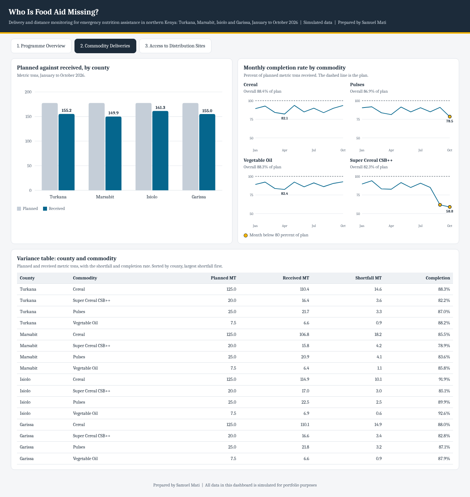

<div align="center">

# Who Is Food Aid Missing?

### Beneficiary Reach, Commodity Supply Chain and Geospatial Access Analysis
### for Humanitarian Food and Nutrition Assistance in Northern Kenya

<br>


**[Live dashboard](https://htmlpreview.github.io/?https://github.com/samuel-mati/Who-is-Food-Aid-Missing/blob/main/dashboard/monitoring_dashboard.html)** &nbsp;|&nbsp; **[Executive memo](docs/Executive_Briefing_Memo.pdf)**

<br>


<br>

[Executive Summary](#executive-summary) &nbsp;|&nbsp; [Business Problem](#business-problem) &nbsp;|&nbsp; [Methodology](#methodology) &nbsp;|&nbsp; [Skills and Tools](#specific-skills-and-tools) &nbsp;|&nbsp; [Results and Recommendations](#results-and-business-recommendations) &nbsp;|&nbsp; [Next Steps and Limitations](#next-steps-and-limitations)

</div>

<br>

---

## Executive Summary

A food assistance programme in four of Kenya's driest counties delivered **7,941 of 10,000 targeted monthly rations (79.4%)**, and the average hid who was being left out. Households within 5 km of a distribution site were reached **92.4%** of the time. Households more than 10 km away were reached **52.1%**. Nearly one in four households (22.8%) lives that far out.

I cleaned and modelled the registration and delivery data, measured every household's distance to its nearest active site, and tested what it would take to close the gap. **Reopening two suspended sites and adding five new ones lifts the share of households within 5 km from 54.2% to 87.1%.** Four commodity supply breaks and one pipeline risk (Super Cereal at 58.8% of plan in October) need attention in parallel.

<div align="center">

| Rations delivered | Reach gap by distance | Households within 5 km of a site |
|:---:|:---:|:---:|
| **79.4%** | **92.4% vs 52.1%** | **54.2% now, 87.1% after the fix** |
| 7,941 of 10,000 | within 5 km vs beyond 10 km | reopen 2 sites, add 5 new sites |

</div>

---

## Business Problem

Food assistance agencies such as **WFP, Catholic Relief Services** and other nutrition partners answer to funders and communities on one question:

> **Are emergency nutrition commodities reaching the vulnerable households they were meant for, on schedule, and who is being left out?**

Programme averages cannot answer it. A county can look "on track" while its most remote households go months without a ration, and a headline delivery rate says nothing about whether the cause is a supply break, a closed site or simple distance.

This project works that problem end to end across **4 counties** (Turkana, Marsabit, Isiolo, Garissa), **1,000 households**, **16 distribution sites** and **10 months** (January to October 2026). It is built for the people who must turn distribution records into decisions: monitoring, evaluation, accountability and learning (MEAL) officers, programme managers, supply chain leads and country directors.

---

## Methodology

<div align="center">

```
Raw registration and        Clean and           Relational        Distance and          Dashboard and
distribution extracts  -->  validate       -->  model and    -->  site access      -->  executive memo
(1,040 registrations,       (every fix          SQL analysis      analysis
 errors left in)             logged)
```

</div>

| Stage | What I did | Why this approach |
|---|---|---|
| **Data quality** | Removed 40 duplicate registrations, filled and flagged 36 missing vulnerability scores, fixed 9 bad coordinates, corrected 8 swapped quantities, quarantined 4 lines from unknown sites. | Every fix is written to a log, so nothing changes silently and a reviewer can audit it. |
| **Data model** | Built a relational model with primary keys, foreign keys and check constraints (see [`docs/erd.png`](docs/erd.png)). | Constraints catch bad data at load time instead of in the dashboard. |
| **Supply analysis** | Seven SQL queries: month on month completion by county, shortfall ranking by commodity, running reach totals, site league table, and outlier months. | Window functions answer "which county, which month, how far below its own normal" in one query. |
| **Access analysis** | Calculated the straight line distance from every household to its nearest active site, banded it (within 5 km, 5 to 10 km, over 10 km) and ran a site search for the best new locations. | Distance explains missed rations better than any county average, and it needs no GIS licence. |
| **Reporting** | Built a three page interactive dashboard and a briefing memo written for senior leadership. | Analysts find the answer. Leaders only act on it if they can see it and read it in five minutes. |

---

## Specific Skills and Tools

| Tool | Techniques used in this project |
|---|---|
| **SQL** | Common table expressions, `LAG`, `SUM OVER`, `RANK`, `AVG OVER` partitions, conditional aggregation, primary and foreign keys, check constraints, indexes |
| **Python** (pandas, numpy) | Duplicate detection, median imputation with flags, coordinate validation, haversine distance, greedy site selection, reproducible seeded data generation |
| **Dashboard** (HTML, SVG, JavaScript) | Heatmap, small multiples, scenario toggles, county filters and a household level coverage map, all in a single file with no server |
| **Power BI** | DAX measures (`DIVIDE`, `CALCULATE`, `DATEADD`) and a relationship design in [`powerbi/dax_measures.txt`](powerbi/dax_measures.txt) so the dashboard can be rebuilt in Power BI |
| **Data modelling** | Entity relationship design, constraint based validation |
| **Communication** | Executive memo that leads with findings and ends with sequenced recommendations |

---

## Results and Business Recommendations

### Distance decides who gets fed

Same programme, same commodities, same months. The only thing that changes is how far the household lives from the nearest active site.

```
Within 5 km  ██████████████████████░░  92.4%
5 to 10 km   ██████████████████░░░░░░  75.8%
Over 10 km   █████████████░░░░░░░░░░░  52.1%
```

### Where the pipeline broke

Overall, **621.4 of 710.0 metric tons (87.5%)** of planned commodity arrived. The average hides four county level breaks and one open risk.

| County | Month | Share of plan received |
|---|---|:---:|
| Marsabit | March | **60%** |
| Marsabit | April | **53%** |
| Turkana | June | **66%** |
| Garissa | August | **71%** |

**Open risk:** Super Cereal, the fortified product for young children, fell to **61.7%** and **58.8%** of plan in September and October in every county at once. Because it hit everywhere together, it looks like an upstream supply problem rather than a local delivery failure.

<div align="center">

</div>

### Who lives too far away

Share of households within 5 km of an active site, by county:

```
Isiolo    ███████████████████░░░░░  77.6%
Garissa   ██████████████░░░░░░░░░░  58.0%
Turkana   ██████████░░░░░░░░░░░░░░  42.4%
Marsabit  █████████░░░░░░░░░░░░░░░  38.8%
```

A third of households in Marsabit and Turkana live more than 10 km from a site. Two of the 16 sites are suspended, which leaves the households around them 14 to 15 km from the nearest active point.

<div align="center">

</div>

### Recommendations

```
Today                     █████████████░░░░░░░░░░░  54.2%
Reopen 2 suspended sites  ███████████████░░░░░░░░░  63.5%
Reopen + add 5 new sites  █████████████████████░░░  87.1%
```

| Priority | Recommendation | Expected impact |
|:---:|---|---|
| **1** | **Reopen the two suspended sites**, after confirming access constraints with field teams | Households within 5 km rise from 54.2% to 63.5%, using infrastructure that already exists |
| **2** | **Open five new sites** at the locations the model recommends | Coverage reaches 87.1%. Marsabit alone goes from 38.8% to 94.8% |
| **3** | **Secure the Super Cereal pipeline** before the next cycle | Closes the one shortfall that hit every county together |
| **4** | **Capture GPS and a unique household ID at registration** | Stops the duplicate registrations that inflated this caseload by 40 records |

---

## Next Steps and Limitations

**With more time I would:**

- Replace straight line distance with walking time over real roads and terrain, so the 5 km rule reflects the actual journey.
- Add site opening and running costs, and optimise for coverage gained per dollar instead of coverage alone.
- Link access to nutrition outcomes such as screening and admission data, to show whether distance also predicts malnutrition.
- Forecast supply breaks from past delivery patterns so teams are warned before a shortfall, not after.
- Automate the monthly refresh so the dashboard updates when new distribution data lands.

**Limitations to keep in mind:**

- **The data is simulated.** It was built to demonstrate the method and does not describe any real programme, organisation or county outcome.
- Straight line distance understates real travel, so true access is worse than shown.
- The 5 km threshold is an assumption and can be set to any programme standard.
- New site recommendations come from a greedy search that assumes the suspended sites reopen. It is a screening tool, not a full location optimisation.
- Missing vulnerability scores were filled with the county median and flagged, so they can be excluded.

---

<div align="center">

**Built by Samuel Mati** &nbsp;|&nbsp; Data analytics for humanitarian programmes

**[Live dashboard](https://htmlpreview.github.io/?https://github.com/samuel-mati/Who-is-Food-Aid-Missing/blob/main/dashboard/monitoring_dashboard.html)** &nbsp;|&nbsp; **[Executive memo](docs/Executive_Briefing_Memo.pdf)** &nbsp;|&nbsp; **[Database design](docs/erd.png)**

</div>
