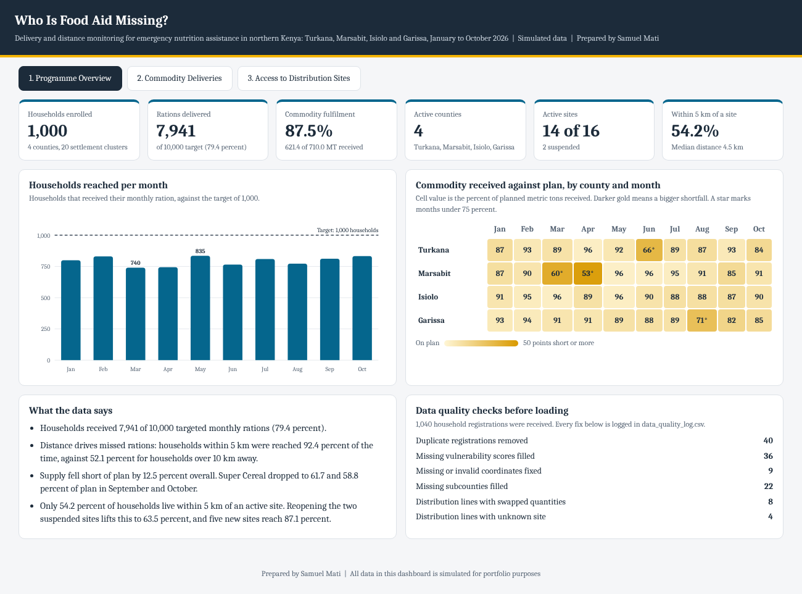

<div align="center">

# Who Is Food Aid Missing?

### Households that live more than 10 km from a distribution site receive their rations barely half the time.
### This project finds them, measures the gap and shows how to close it.

<br>


**[Open the live dashboard](https://htmlpreview.github.io/?https://github.com/samuel-mati/Who-is-Food-Aid-Missing/blob/main/dashboard/monitoring_dashboard.html)**  &nbsp;·&nbsp;  **[Read the executive memo](docs/Executive_Briefing_Memo.docx)**

<br>



</div>

<br>

---

## The question every food assistance programme has to answer

> **Are emergency nutrition commodities reaching the vulnerable households they were meant for, on schedule, and who is being left out?**

Funders ask it. Country directors ask it. Field teams feel the answer before any report confirms it. This project answers it with data across **four of Kenya's driest counties** (Turkana, Marsabit, Isiolo and Garissa), **1,000 households**, **16 distribution sites** and **ten months** of deliveries.

---

## The answer in 30 seconds

<div align="center">

|  Rations delivered |  The hidden driver |  The fix |
|:---:|:---:|:---:|
| **7,941 of 10,000** | **92% vs 52%** | **54% → 87%** |
| 2,059 monthly rations never reached a household | reach rate within 5 km versus beyond 10 km | households within 5 km of a site, after reopening 2 sites and adding 5 |

</div>

---

## Slide 1 &nbsp;|&nbsp; Distance decides who eats

Same programme. Same commodities. Same months. The only thing that changes is how far the household lives from the nearest active site.

```
Within 5 km  ██████████████████████░░  92.4%
5 to 10 km   ██████████████████░░░░░░  75.8%
Over 10 km   █████████████░░░░░░░░░░░  52.1%
```

Nearly **one in four households (22.8%)** lives more than 10 km from an active site. Those are the households the monthly average hides.

---

## Slide 2 &nbsp;|&nbsp; Where the pipeline broke

Overall, **621.4 of 710.0 metric tons (87.5%)** of planned commodity arrived. The average hides four county level breaks and one open risk:

| Break | County | Month | Share of plan received |
|---|---|---|:---:|
| 1 | Marsabit | March | **60%** |
| 2 | Marsabit | April | **53%** |
| 3 | Turkana | June | **66%** |
| 4 | Garissa | August | **71%** |

**Open risk:** Super Cereal (the fortified product for young children) fell to **61.7%** and **58.8%** of plan in September and October, **in every county at once**. Because it hit every county at once, it looks like an upstream supply problem rather than a local delivery failure.

<div align="center">

</div>

---

## Slide 3 &nbsp;|&nbsp; The map of who lives too far away

Share of households within 5 km of an active site, by county:

```
Isiolo    ███████████████████░░░░░  77.6%
Garissa   ██████████████░░░░░░░░░░  58.0%
Turkana   ██████████░░░░░░░░░░░░░░  42.4%
Marsabit  █████████░░░░░░░░░░░░░░░  38.8%
```

Marsabit and Turkana are in trouble: **a third of households in each live more than 10 km from a site.** Two of the 16 sites are suspended, and the households around them are left 14 to 15 km from the nearest active point.

<div align="center">

</div>

---

## Slide 4 &nbsp;|&nbsp; What to do about it

```
Today                     █████████████░░░░░░░░░░░  54.2%
Reopen 2 suspended sites  ███████████████░░░░░░░░░  63.5%
Reopen + add 5 new sites  █████████████████████░░░  87.1%
```

| Priority | Action | Why it comes first |
|:---:|---|---|
| **1** | **Reopen the two suspended sites** | Cheapest gain: +9.3 points of coverage with infrastructure that already exists. Confirm access constraints with field teams first. |
| **2** | **Open five new sites** at the locations the model recommends | Takes coverage to 87.1%. Marsabit alone goes from 38.8% to 94.8%. |
| **3** | **Secure the Super Cereal pipeline** before the next cycle | The only shortfall that hit every county at the same time. |
| **4** | **Capture GPS and a unique household ID at registration** | Prevents the duplicate registrations that inflate caseloads. |

---

## Slide 5 &nbsp;|&nbsp; Why you can trust the numbers

**1,040 registrations went in. 1,000 households came out.** Every fix is logged, so nothing is changed silently.

| Check before analysis | Records |
|---|:---:|
| Duplicate registrations removed | 40 |
| Missing vulnerability scores filled and flagged | 36 |
| Invalid or missing coordinates fixed | 9 |
| Distribution lines with swapped quantities, flagged for field confirmation | 8 |
| Distribution lines from unknown sites, quarantined | 4 |

---

## Who this is for

Built for the teams that have to turn distribution records into decisions: **monitoring, evaluation, accountability and learning (MEAL) officers, programme managers, supply chain and logistics leads, and country directors** at organisations such as **WFP, Catholic Relief Services** and other food and nutrition agencies. Swap in real programme data and the same pipeline produces the same report.

## What is in the box

| | Deliverable | What it does |
|---|---|---|
| | **[Interactive dashboard](https://htmlpreview.github.io/?https://github.com/samuel-mati/Who-is-Food-Aid-Missing/blob/main/dashboard/monitoring_dashboard.html)** | Three pages: programme overview, commodity deliveries, access to distribution sites. Filter by county and test scenarios on the map. |
| | **[Executive briefing memo](docs/Executive_Briefing_Memo.docx)** | The findings and recommendations written for senior leadership. |
| | **Relational database and 7 SQL queries** | Keys, constraints and window functions (`LAG`, `SUM OVER`, `RANK`) behind every number. |
| | **Python cleaning and spatial analysis** | Data quality checks, distance bands and a new site search, with no GIS licence needed. |
| | **Power BI measures** | DAX and relationships so the dashboard can be rebuilt in Power BI. |

---

## Skills on display

`SQL window functions` &nbsp;·&nbsp; `Data cleaning and validation` &nbsp;·&nbsp; `Spatial analysis` &nbsp;·&nbsp; `Dashboard design` &nbsp;·&nbsp; `DAX` &nbsp;·&nbsp; `Data modelling` &nbsp;·&nbsp; `Executive communication` &nbsp;·&nbsp; `MEAL`

---

> **A note on the data.** Everything here is **simulated** to demonstrate the method. It does not describe any real programme, organisation or county outcome. Distances are straight line, so real walking routes will be longer and true access worse than shown. The 5 km threshold is an assumption and can be set to any programme standard.

<details>
<summary><b>For analysts: method notes</b></summary>

<br>

- Distances are haversine (straight line) from household coordinates to the nearest active site. The 5 km threshold is the constant `WALK_KM` in `python/walk_less_analysis.py`.
- Duplicates are matched on head of household, settlement and household size. The earliest registration is kept.
- Missing vulnerability scores are filled with the county median and flagged so they can be excluded.
- Where received exceeds dispatched, the two values are treated as swapped and flagged for field confirmation.
- Recommended sites come from a greedy search that first assumes the suspended sites reopen. It is a screening tool, not a full location optimisation.
- Data is seeded, so every run of the pipeline produces identical results. Entity relationship diagram: [`docs/erd.png`](docs/erd.png).

</details>

<br>

<div align="center">

**Built by Samuel Mati** &nbsp;|&nbsp; Data analytics for humanitarian programmes

</div>
